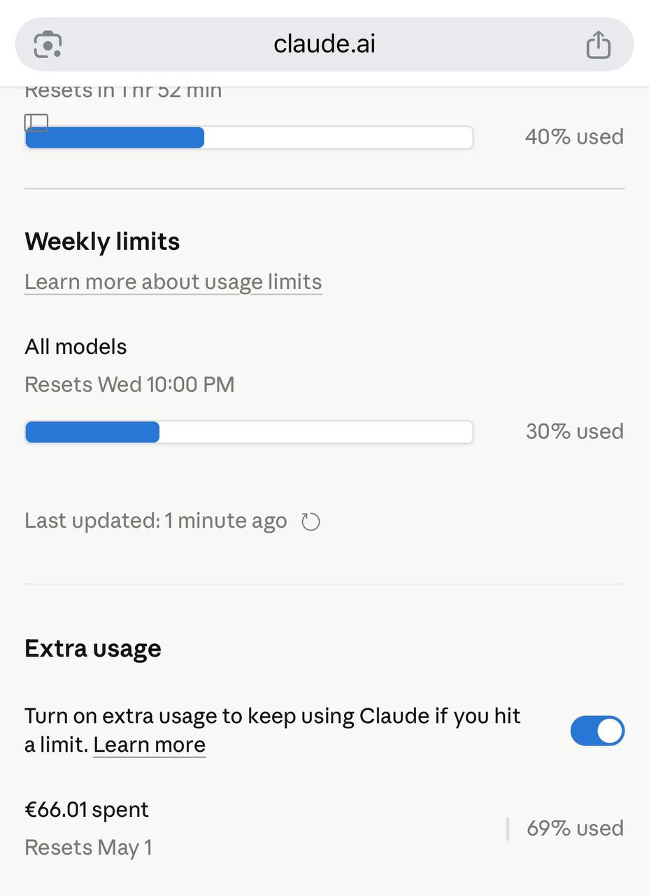

Running a blog for over a decade means accumulating a lot of technical debt. Commands change, tools get deprecated, Python 2 becomes Python 3, and posts that were accurate in 2013 start quietly misleading readers in 2026. For systutorials.com, that meant roughly 1,375 posts needed attention — some desperately.

Doing that manually would take months. Here’s how we did it in two days for €66 using <a href="https://openclaw.ai" rel="nofollow noopener" target="_blank">OpenClaw</a> and Claude.

## The problem

The site had posts from as far back as 2010. A few issues that kept coming up:

- Commands using deprecated flags or syntax
- References to Python 2, outdated package managers, dead tools (mencoder, gitosis, etc.)
- Posts that were basically three lines — barely useful
- HTML-only content with no Markdown formatting
- Titles that read like Stack Overflow questions from 2011 (“How to do X thing?”)

Not every post was broken, but enough were that a systematic pass made sense.

## The setup

OpenClaw is a personal AI agent platform that runs Claude (or other models) in a persistent environment with file system access, shell execution, and API integrations. The key part: it can run long background tasks with state persistence, which matters a lot when you’re touching 1,375 posts.

The workflow had three components:

1.  **A Python script** that paginated through the WordPress REST API, fetched post content, sent it to Claude for revision, and pushed the result back
2.  **A state file** (`blog-revision-state.json`) tracking which posts were done, skipped, or failed — so the job could be interrupted and resumed without losing progress
3.  **A watchdog script** that restarted the main process if it died

The WordPress API made the read/write side straightforward:

``` bash
# Fetch posts (oldest first)
GET /wp-json/wp/v2/posts?orderby=date&order=asc&per_page=20&page=N

# Update a post
POST /wp-json/wp/v2/posts/{id}
{ "content": "...", "title": "...", "status": "publish" }
```

## The Claude prompt

Getting the prompt right took a few iterations. The final system prompt covered:

Start every post with ` `

so the WordPress Markdown plugin renders it correctly

Output a `TITLE:` line first with an improved title, then the content

No opening notes, no “updated for 2026” disclaimers, no “what changed” sections — just weave updates in naturally

Don’t start with a Markdown heading — start with a sentence

Replace deprecated tools with modern equivalents

Expand short posts; minimum ~400 words for practical technical content

Direct sysadmin voice, no filler phrases

The title instruction paid off. Titles like “How to upgrade vim to version 8 on CentOS?” became “Upgrading Vim on CentOS 7” — cleaner, more natural, better for search.

## What got skipped

Not everything was worth updating:

- Conference call-for-papers lists from 2011–2014 (outdated by definition)
- Posts already converted to `[md]` format from a previous pass
- Posts with fewer than 50 characters of content (usually just stubs)

About 7 posts fell into these categories and were skipped automatically.

## The failure recovery problem

About halfway through the first pass, the Anthropic API returned 401 errors for roughly 30 minutes — probably a temporary auth issue. The script logged these as failures and moved on rather than halting.

After the full scan completed (70 pages × 20 posts), the script looped back and retried all failed IDs directly, fetching each post by ID rather than paginating. Three retry rounds cleared everything down to zero failures.

The state file was the critical piece here. Without it, any interruption would have meant starting over.

## The post-processing passes

After the main revision pass, two additional passes ran:

**Fix leading headings:** Many revised posts started with a `##` heading immediately after `[md]`. A second script scanned all revised posts, detected this pattern, stripped the leading heading, and pushed the fix back to WordPress. 775 posts needed this fix.

**Retitle pass:** For posts that were revised before the title improvement was added to the prompt, a separate pass fetched each post title, sent it to Claude with a focused “improve this title” prompt, and updated the WordPress title field. 1,243 titles were updated this way.

## Model choice and timing

The bulk of the work used `claude-haiku-4-5` via the Anthropic API. Haiku is fast, cheap, and more than capable of structured rewriting tasks — the bottleneck throughout was the WordPress REST API, not the model. Each post took roughly 12–15 seconds end-to-end: ~10s for Claude to generate the revision, ~2s to push to WordPress, ~2s sleep to avoid hammering the API.

At that pace:

- ~240 posts/hour
- 1,375 posts ÷ 240 ≈ ~6 hours of pure processing time

The actual wall-clock time was closer to **48 hours** across two days, due to:

- A ~30-minute Anthropic API outage mid-run that caused 645 posts to fail (all recovered in retry passes)
- Switching to `claude-sonnet-4-5` for a few hours, which hit 429 rate limits repeatedly and stalled the job — reverted to Haiku to finish
- Three separate retry rounds to clear all failures down to zero
- Two post-processing passes (strip leading headings, retitle already-revised posts) that each took 1–2 hours

Sonnet produces noticeably better prose, but at this scale and tier the rate limits make it impractical for bulk jobs. Haiku hit the sweet spot of speed, quality, and reliability.

## Cost breakdown

The full run — 1,375 posts revised, 1,375 retitled — cost **€66.01** in Anthropic API credits (via Claude.ai’s extra usage billing).



Breaking it down roughly:

- Each post revision: ~1,500 tokens input + ~1,000 tokens output average
- Each retitle call: ~50 tokens input + ~20 tokens output
- Total tokens: ~3.5M input, ~1.5M output
- Haiku pricing: \$0.80/M input, \$4/M output → ~\$8.8 in model costs
- The remaining ~\$57 reflects the retry passes, post-processing passes, and the brief Sonnet usage during the failed rate-limit experiment

For context: hiring someone to manually review and update 1,375 technical posts at even a modest hourly rate would cost tens of thousands of dollars and take months.

## What the output looks like

Every post now:

- Starts with `[md]` for Markdown rendering
- Opens with a sentence, not a heading
- Has a clean, readable title
- Uses modern tools and syntax (ffmpeg instead of mencoder, Python 3, current distro package names)
- Is long enough to actually be useful — short posts were expanded with real examples, edge cases, and related commands

## Running your own pass

The core pattern is reusable for any CMS with an API. The key pieces:

1.  Paginate through your content API
2.  Strip HTML to get plain text for the prompt
3.  Send to your model with a well-structured system prompt
4.  Parse the model output and push back via the API
5.  Track state to handle failures and interruptions

The full script for this run was about 300 lines of Python. The expensive part wasn’t the code — it was getting the prompt right so the output actually sounded like a human wrote it.
